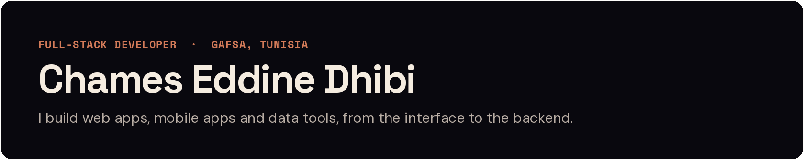

  
  
  
  

I hold a Licence in Computer Science (Software Engineering, 2026) and work as a freelance full-stack developer on Upwork, where I'm a Rising Talent with a 100% Job Success Score. Most of my work is in TypeScript (Next.js, React, Bun, Elysia) on PostgreSQL. I also use Python and Flutter.

## Featured projects

<table>
<tr>
<td width="33%" valign="top">

<b>01</b> · E-COMMERCE · 2026

<h3>printclub</h3>

Photo print studio with an in-browser design editor. Upload, crop, add text and shapes, undo and redo, then export a print preview.

TanStack Start · Elysia · tRPC · Drizzle · PostgreSQL · Bun

<a href="https://printclub.chames.tn">Live site</a> · <a href="https://github.com/Chams99/printclub">Source</a>

</td>
<td width="33%" valign="top">

<b>02</b> · DEVELOPER TOOL · 2026

<h3>WebGrade</h3>

Website audit tool. It runs Lighthouse on mobile and desktop and adds Chrome UX Report field data and security checks. Reports can be shared or saved as PDF.

Next.js · PostgreSQL · Drizzle · Better Auth · Docker

<a href="https://webgrade.chames.tn">Live site</a> · <a href="https://github.com/Chams99/WebGrade">Source</a>

</td>
<td width="33%" valign="top">

<b>03</b> · ACADEMIC WRITING TOOL · 2026

<h3>Rapport Auditor</h3>

Review desk for academic reports, in English and French. It flags repetition, dense sentences, stock phrases and claims that need a source. It previews edits without changing the file.

Python · Flask · Redis · pytest

<a href="https://rapport.chames.tn">Live site</a> · <a href="https://github.com/Chams99/rapport-auditor">Source</a>

</td>
</tr>
</table>

## More public work

| Project | What it is | Stack | Links |
| --- | --- | --- | --- |
| **StageursApp** | Internship management system that generates PDF student badges, built during my internship at CPG | ASP.NET Core MVC, C# | [Source](https://github.com/Chams99/StageCPG1) |
| **Dent** | Website for a dental clinic, with a validated contact form | Next.js, Tailwind CSS, Framer Motion | [Live](https://dent-phi.vercel.app) · [Source](https://github.com/Chams99/Dent) |
| **Meridian Capital** | Real-estate investment website | React, Vite, Tailwind CSS, Vitest | [Live](https://modern-estate-vision.vercel.app) · [Source](https://github.com/Chams99/modern-estate-vision) |
| **FTBall** | Football gear store with product pages and a cart | Next.js, Zustand, Radix UI | [Live](https://ftball-ten.vercel.app) · [Source](https://github.com/Chams99/FTBALL) |
| **Evolution** | Natural-selection simulator in which creatures evolve size, speed and sense range | Flutter, Dart | [Source](https://github.com/Chams99/Evolution) |
| **LolChat** | Chat app where each League of Legends champion answers in its own voice | JavaScript, Cloudflare Pages Functions | [Live](https://lolchat.vercel.app) · [Source](https://github.com/Chams99/Lolchat) |

### Also live on chames.tn (private source)

- [**AssistantAI**](https://dbmanager.chames.tn): assistants that answer from a database, a website or a manual, using read-only queries
- [**SSpace**](https://sspace.chames.tn): astronomy explorer with a sky map, an object catalog and a 24-hour observing planner
- [**Universal Convertal**](https://units.chames.tn): converters for 73 units, currency rates and images

## Tech stack

- **Languages:** TypeScript, JavaScript, Python, C#, Dart, PHP, SQL
- **Frontend and mobile:** React, Next.js, TanStack Start, Astro, Tailwind CSS, Flutter
- **Backend:** Node.js, Bun, Elysia, Express, tRPC, Flask, FastAPI, ASP.NET Core
- **Data:** PostgreSQL, MySQL, Redis, SQLite, Drizzle ORM
- **Tooling:** Git, Docker, Linux, pnpm, Vite, Turborepo

## Experience and education

- **Full-stack developer (freelance)**, Upwork · Jul 2025 – present
- **Final-year project intern, software engineering**, Compagnie des Phosphates de Gafsa (CPG) · Mar – May 2026
- **Software development and cybersecurity intern**, CPG · Jun – Aug 2025
- **Licence in Computer Science, Software Engineering**, Faculté des Sciences de Gafsa · 2023 – 2026

IELTS Academic 7.0 (2026) · TOEFL iBT 84 (2025) · Arabic, English, French, German

---

Open to freelance projects. Reach me at [dhibichams@gmail.com](mailto:dhibichams@gmail.com) or see more of my work at [chames.tn](https://chames.tn).
